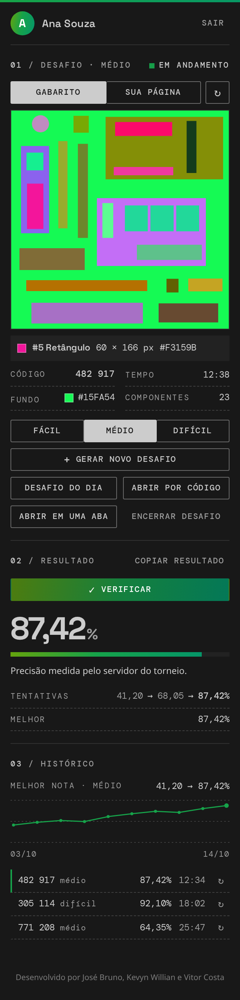

# FlexBox Trainer

Extensão do VS Code para treinar a recriação de layouts em HTML e CSS, no formato do torneio Frontend Teams Cup. A extensão gera um desafio, você o recria em `index.html` e `style.css`, e o servidor do torneio corrige a sua página e devolve a precisão.

  

- **Para treinar:** baixe o `.vsix` da [versão mais nova](https://github.com/josebruno10/flexbox-trainer/releases/latest) e siga o [README da extensão](../extensao/README.md).
- **Para desenvolver:** a extensão inteira fica em [`extensao/`](../extensao/); abra essa pasta no VS Code. Veja [Para quem desenvolve](../extensao/docs/MANUAL.md#para-quem-desenvolve), no manual.

Desenvolvido por José Bruno, Kevyn Willian e Vitor Costa. Licença MIT.
