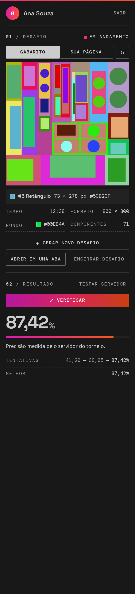
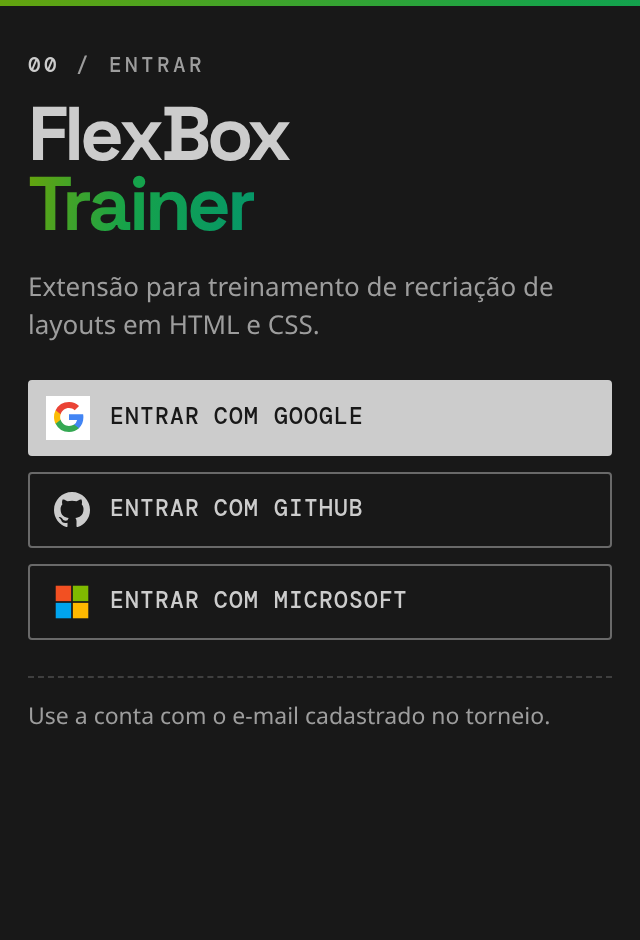
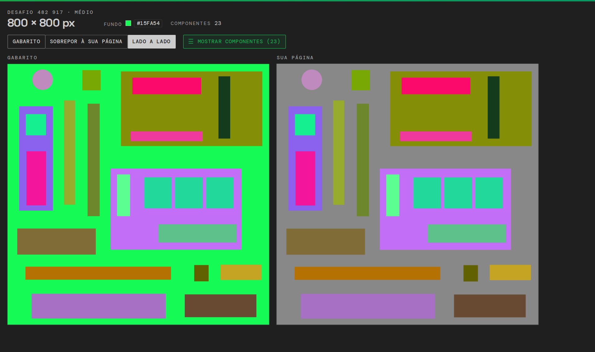
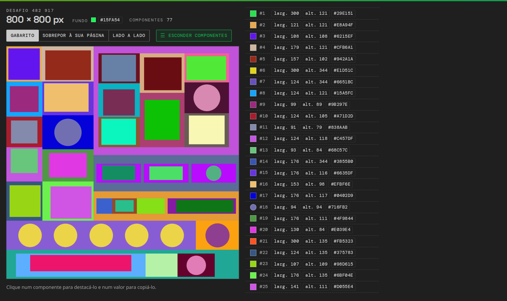

# Manual do FlexBox Trainer

Tudo sobre a extensão: instalação, uso, regras, comandos, configurações, problemas comuns e desenvolvimento. O resumo está no [README](../README.md).

<p align="center">
  
  &nbsp;&nbsp;
  
</p>

<p align="center">
  
</p>

## O que ela faz

- Gera desafios aleatórios de 800 × 800 px, com cabeçalhos, colunas, grades de cartões e fileiras de círculos, em três níveis: fácil, médio e difícil.
- Mostra o tamanho e a cor de cada componente do gabarito, na barra lateral ou em uma aba do editor.
- Atualiza a pré-visualização da sua página enquanto você digita, sem precisar salvar.
- Compara o gabarito com a sua página, sobrepostos ou lado a lado.
- Envia a sua página para o servidor do torneio corrigir e mostra a precisão oficial. As correções de treino não entram no ranking.
- Como a extensão oficial do torneio, não aceita IA durante o desafio: não deixa começar nem corrigir com extensões de IA habilitadas (Copilot, Claude Code, Codex, Continue, Cline e outras) e invalida o desafio se uma delas for habilitada ou se o código for alterado fora do editor (veja [As regras do desafio](#as-regras-do-desafio)).
- Cria o `index.html` e o `style.css` quando a pasta ainda não os tem.
- Marca o tempo de cada tentativa.
- Dá a cada desafio um código de 6 dígitos: com o mesmo código, a turma toda treina o mesmo layout, e o aluno pode refazer um desafio. O desafio do dia é o mesmo para todos na mesma data.
- Guarda um histórico com a melhor nota e o tempo de cada desafio, e copia o resultado para você mandar à turma.
- Mostra a sua evolução, com a melhor nota de cada dia num gráfico.
- Avisa quando sai uma versão nova e, no VS Code desktop, se atualiza com um clique.

## Requisitos

- VS Code 1.110 ou mais novo.
- Uma conta cadastrada no Frontend Teams Cup, com o mesmo e-mail que você vai usar para entrar (de preferência pelo Google).
- Internet: a extensão valida a sua conta no servidor do torneio ao abrir, e a correção também é feita lá.

## Instalar e abrir

### Pelo arquivo `.vsix` (para treinar)

1. Baixe o arquivo `.vsix` da versão mais nova, em [Releases](https://github.com/josebruno10/flexbox-trainer/releases/latest) (em **Assets**).
2. No VS Code, abra **Extensões** (`Ctrl+Shift+X`), clique nos **⋯** do topo do painel e escolha **Instalar do VSIX...**. Ou, no terminal: `code --install-extension flexbox-trainer-0.5.1.vsix`.
3. Abra uma pasta para treinar (**Arquivo → Abrir Pasta**). Pode ser uma pasta vazia: a extensão cria o `index.html` e o `style.css`.

Para atualizar, instale o `.vsix` novo do mesmo jeito. Uma vez por dia, a extensão confere no GitHub se saiu uma versão nova e avisa. No VS Code desktop, **Atualizar** baixa e instala a versão nova; depois, é só recarregar a janela. No VS Code pelo navegador, **Baixar** abre a página da versão. A consulta não envia nada seu. Na primeira vez que uma versão nova abre, a extensão avisa, com o link do que mudou.

### Pelo código (para desenvolver)

Você vai precisar de Git, Node.js 20 ou mais novo e VS Code.

```bash
git clone https://github.com/josebruno10/flexbox-trainer.git
cd flexbox-trainer
npm install
code .
```

No VS Code, abra **Executar e Depurar** (`Ctrl+Shift+D`), escolha **Run Extension (Desktop)** e aperte **F5**. Uma nova janela abre com a pasta `exemplo-treino`, que já tem um `index.html` e um `style.css` de exemplo. O primeiro desafio pergunta se pode limpá-los; depois, `git restore exemplo-treino` traz o exemplo de volta.

Essa janela usa as extensões que você tem instaladas. Se alguma for de IA, você não consegue começar nem corrigir desafios até desabilitá-la (veja [Problemas comuns](#problemas-comuns)).

Se você já tinha o projeto, rode `git pull` e `npm install` antes. Para gerar o `.vsix`, rode `npx @vscode/vsce package`.

## Primeiro uso

Na primeira vez que a extensão roda, ela abre o **guia de primeiros passos**, que mostra cada passo abaixo e marca o que você já fez. Para abri-lo de novo, use **FlexBox Trainer: Guia de Primeiros Passos** ou o menu **⋯** do topo da barra lateral.

1. Clique no ícone do **FlexBox Trainer** na barra de atividades, à esquerda.
2. Entre com **Google**, **GitHub** ou **Microsoft**. Use a conta cujo e-mail está cadastrado no torneio. Se o e-mail não estiver cadastrado, a barra lateral avisa em amarelo e a correção não funciona.
3. Clique em **Gerar novo desafio**. Se a pasta aberta ainda não tiver `index.html` e `style.css`, a extensão os cria com uma base mínima e os abre. Sem pasta aberta, ela oferece **Abrir pasta**.
4. Na primeira vez que clicar em **Verificar**, a extensão pergunta se pode criar a sua **dinâmica de treino**: um espaço só seu no servidor, onde ela guarda a imagem do desafio para corrigir. Clique em **Criar dinâmica de treino** e confirme o código sugerido. Isso acontece uma única vez.

## Como treinar

1. Escolha o nível logo acima de **Gerar novo desafio**: **Fácil**, **Médio** ou **Difícil**. Nos mais fáceis saem os componentes menores, que dão mais trabalho (metade deles no fácil e 30% no médio); o difícil tem todos. A escolha fica guardada. **Gerar novo desafio** (`Ctrl+Alt+D`) cria uma imagem nova e deixa o `index.html` e o `style.css` só com a base. Gere quantas quiser até achar um desafio para treinar; o cronômetro recomeça a cada desafio. Para treinar um desafio que alguém passou, use **Abrir por código** e digite os 6 dígitos; **Desafio do dia** abre o de hoje, o mesmo para todos.
2. Recrie a imagem em `index.html` e `style.css`. Pode usar flexbox, grid ou `position`: o que conta é o resultado na tela. A sua página é desenhada numa área do tamanho do gabarito (800 × 800 px), como no torneio: o `html` e o `body` já têm esse tamanho, e o que passar dele fica de fora. Não precisa definir o tamanho da página; basta preencher essa área (por exemplo, com `height: 100%` no elemento que envolve o layout).
3. Para consultar medidas e cores, clique em um componente do gabarito na barra lateral, ou use **Abrir em uma aba** para ver todos de uma vez.
4. A pré-visualização e a comparação acompanham o que você digita, sem precisar salvar. Na barra lateral, **Gabarito | Sua página** alterna os dois no mesmo quadro, o que deixa à vista onde eles diferem.
5. Clique em **Verificar** (ou aperte `Ctrl+Alt+V`, mesmo com a barra lateral fechada). A barra lateral mostra as etapas e, no fim, a precisão medida pelo servidor do torneio.
6. Ajuste e verifique de novo. Abaixo da nota ficam as últimas tentativas do desafio e a melhor delas. Se a sua página não mudou desde a última verificação, a extensão não a reenvia: ela repete a nota e avisa.
7. **Encerrar desafio** congela o cronômetro quando você terminar. Depois, **↻ Refazer** começa o mesmo desafio de novo, do zero.

Só contam elementos com cor de fundo sólida (`background` ou `background-color`). Texto, imagens, gradientes e sombras não são comparados.

### Código do desafio, desafio do dia e histórico

Cada desafio tem um **código** de 6 dígitos, que aparece nos dados do desafio (clique nele para copiar) e no topo da aba do gabarito. O mesmo código gera sempre a mesma imagem, no mesmo nível: o nível vem do próprio código, e aparece no título da seção (por exemplo, **Desafio · médio**). Quem abre o código de um colega treina o mesmo nível dele, qualquer que seja o nível escolhido.

- **Em sala:** o professor passa um código, e cada aluno abre o desafio com **Abrir por código**. Todos treinam o mesmo layout, cada um na própria dinâmica de treino.
- **Desafio do dia:** sem ninguém passar um código, **Desafio do dia** abre o desafio da data, o mesmo para todos que o abrirem no mesmo dia (vale a data do computador). Ele é sempre médio. Enquanto ele está aberto, a seção se chama **Desafio do dia**.
- **Sozinho:** refaça um desafio para tentar uma nota maior ou um tempo menor.

O **Histórico**, abaixo do Resultado, mostra os desafios que você já verificou, do mais recente ao mais antigo, com a melhor nota e o tempo em que ela foi alcançada. O ↻ de cada linha refaz aquele desafio, e **Ver todos** (ou **FlexBox Trainer: Histórico de Desafios**) lista até 30. Ao refazer um desafio, o Resultado mostra também o seu **Recorde** nele, a nota a bater.

No topo do Histórico, com dois dias de treino ou mais, o gráfico **Melhor nota** mostra a sua evolução no nível escolhido: a melhor nota de cada dia, de 0 a 100%, com a primeira e a última nota ao lado do título. Pare o mouse sobre um ponto para ver o dia e a nota.

O histórico fica separado por e-mail: num laboratório, cada aluno vê os próprios desafios. Com a **Sincronização de Configurações** do VS Code ligada (ícone da conta, embaixo à esquerda), o histórico, o gráfico e a sequência vão com você para os outros computadores em que você usar o VS Code, junto com o nível escolhido. Só os seus: os de outros alunos que usaram o mesmo computador não vão.

Depois da primeira nota, **Copiar resultado**, no topo do Resultado, copia o código, a melhor nota desta tentativa e o tempo em que ela saiu, para colar no grupo da turma:

```text
Desafio médio 482 917: 87,42% em 12:34
Desafio do dia 14/10 (071 881): 87,42% em 12:34
```

## As regras do desafio

Como no torneio, o desafio é feito do começo ao fim no editor, sem IA:

- Não dá para começar um desafio com extensões de IA habilitadas no VS Code.
- Se uma extensão de IA for habilitada durante o desafio, ele é **invalidado**, mesmo que você a desabilite depois.
- Se o `index.html` ou o `style.css` forem alterados fora do editor durante o desafio, ele também é invalidado. Isso pega assistentes de IA que rodam no terminal e gravam direto nos arquivos, mas vale para qualquer programa ou comando (outra janela do VS Code, `git checkout`, um formatador rodado no terminal).
- Um desafio invalidado não pode mais ser corrigido: a barra lateral mostra o motivo, e é só gerar outro.
- Cada desafio começa do zero. Ao gerar um desafio novo, o `index.html` e o `style.css` voltam à base (o HTML mínimo e o reset do CSS: `box-sizing`, `margin` e `padding`), para nada do desafio anterior ser reaproveitado e o tempo contar o desafio inteiro. Se você escreveu algo, a extensão pergunta antes de limpar; com o arquivo aberto, `Ctrl+Z` no editor desfaz a limpeza.

Salvar no editor, inclusive com formatação ao salvar, e criar ou limpar os arquivos pela extensão não contam como alteração de fora.

## A barra lateral

A barra lateral tem três partes: **Desafio** (o quadro, que alterna entre o gabarito e a sua página, as medidas e os dados do gabarito, com o código), **Resultado** (o **Verificar**, a precisão e as tentativas) e **Histórico**, que aparece depois da primeira verificação. Se faltar o `index.html` ou o `style.css` na pasta aberta, o Resultado avisa e oferece criá-los. O caminho dos arquivos usados aparece ao parar o mouse sobre **Sua página**.

| Botão | O que faz |
|---|---|
| Gabarito, Sua página | Alternam o que o quadro mostra: o gabarito ou a sua página |
| Fácil, Médio, Difícil | Escolhem o nível dos desafios novos; a escolha fica guardada |
| Gerar novo desafio | Cria um desafio novo, no nível escolhido, e reinicia o cronômetro (`Ctrl+Alt+D`) |
| Desafio do dia | Abre o desafio de hoje, o mesmo para todos na mesma data |
| Abrir por código | Abre o desafio de um código de 6 dígitos, como o que o professor passar |
| O código, nos dados do desafio | Copia o código, para outra pessoa abrir o mesmo desafio |
| Encerrar desafio | Congela o cronômetro do desafio atual |
| ↻ Refazer | Aparece depois de encerrar, no lugar de Encerrar desafio; começa o mesmo desafio de novo, do zero |
| Abrir em uma aba | Abre o gabarito, as medidas e a comparação em uma aba do editor |
| ↻ (ao lado de Sua página) | Atualiza a sua página na hora. Ela já atualiza sozinha enquanto você digita; use se demorar |
| Criar index.html e style.css | Aparece quando falta algum dos dois; cria só o que falta, sem sobrescrever nada |
| Ver extensões | Aparece no aviso de extensões de IA; abre a página delas para você desabilitar |
| Verificar | Mede a sua página e envia para a correção (`Ctrl+Alt+V`) |
| Copiar resultado | Aparece depois da primeira nota; copia o código, a melhor nota e o tempo dela |
| ↻, no Histórico | Refaz aquele desafio |
| Ver todos, no Histórico | Lista todos os desafios do histórico; escolher um o refaz |
| Sair | Encerra a sua sessão |

Enquanto há um desafio, a barra de status, embaixo da janela, mostra o tempo e a última precisão, mesmo com a barra lateral fechada. Clique nela para abrir a barra lateral.

No topo da barra lateral, o ícone de paleta escolhe as cores de destaque da extensão (veja [Configurações](#configurações)), e o menu **⋯** tem **Desafio do Dia**, **Abrir Desafio por Código**, **Refazer o Desafio Atual**, **Histórico de Desafios**, **Copiar Resultado**, o **Guia de Primeiros Passos** e o **Testar Servidor**, que confere se a sua sessão está valendo. A extensão já testa o servidor sozinha a cada desafio novo e só avisa se der erro.

## A aba do gabarito

Abra pelo botão **Abrir em uma aba**, pelo atalho **Abrir gabarito em uma aba** que aparece no topo do `index.html` e do `style.css`, ou pela paleta de comandos. A aba acompanha o desafio atual e tem três modos:

- **Gabarito**: a imagem grande e a lista de todos os componentes, um por linha, com largura, altura e cor. Os círculos também aparecem em largura e altura, como você os faz com `border-radius`, e têm a amostra redonda. Clique em um componente, na imagem ou na lista, para destacá-lo por alguns segundos (Esc tira o destaque na hora); clique em um valor para copiá-lo.
- **Sobrepor à sua página**: o gabarito por cima da sua página. Arraste o controle entre "Sua página" e "Gabarito" para ver onde cada uma difere.
- **Lado a lado**: o gabarito e a sua página, um ao lado do outro. A lista começa escondida, para as imagens ficarem maiores.

O botão **Componentes** mostra ou esconde a lista em qualquer modo.

A sua página aparece na aba exatamente como ela é medida para a correção, e acompanha o que você digita.

<p align="center">
  
</p>

## Comandos

Abra a paleta com `Ctrl+Shift+P` e digite "FlexBox Trainer".

| Comando | O que faz |
|---|---|
| FlexBox Trainer: Fazer Login | Abre o login pelo Google no navegador |
| FlexBox Trainer: Sair | Encerra a sessão |
| FlexBox Trainer: Iniciar | Abre a barra lateral (e o login, se precisar) |
| FlexBox Trainer: Gerar Novo Desafio | Sorteia um desafio novo |
| FlexBox Trainer: Desafio do Dia | Abre o desafio de hoje, o mesmo para todos na mesma data |
| FlexBox Trainer: Abrir Desafio por Código | Abre o desafio de um código de 6 dígitos |
| FlexBox Trainer: Verificar | Verifica a sua página, como o botão da barra lateral |
| FlexBox Trainer: Copiar Resultado | Copia o código, a melhor nota e o tempo do desafio atual |
| FlexBox Trainer: Refazer o Desafio Atual | Começa o desafio atual de novo, do zero |
| FlexBox Trainer: Histórico de Desafios | Lista os desafios já verificados; escolher um o refaz |
| FlexBox Trainer: Guia de Primeiros Passos | Abre o guia na tela de boas-vindas do VS Code |
| FlexBox Trainer: Abrir Gabarito em uma Aba | Abre a aba do gabarito |
| FlexBox Trainer: Criar index.html e style.css | Cria na pasta aberta os arquivos que faltarem |
| FlexBox Trainer: Ver Extensões de IA Habilitadas | Mostra as extensões de IA que impedem começar e corrigir desafios e abre a página delas |
| FlexBox Trainer: Criar Dinâmica de Treino | Cria a sua dinâmica de treino, se você não a criou no primeiro Verificar |
| FlexBox Trainer: Testar Servidor | Confere se a sua sessão está valendo no servidor |
| FlexBox Trainer: Escolher Cores | Troca as cores de destaque da extensão |

## Atalhos

| Atalho | O que faz | Quando funciona |
|---|---|---|
| `Ctrl+Alt+D` | Gera um novo desafio | Com a sessão aberta |
| `Ctrl+Alt+V` | Verifica a sua página; abre a barra lateral, se estiver fechada | Com um desafio |

No Mac, use Control e Option no lugar de Ctrl e Alt. Para trocar um atalho, abra **Arquivo → Preferências → Atalhos de Teclado** e busque por "FlexBox Trainer".

## Configurações

Em **Arquivo → Preferências → Configurações**, aba **Usuário**, busque por "flexboxTrainer".

| Configuração | Para que serve |
|---|---|
| `flexboxTrainer.eventoTreino` | Código da sua dinâmica de treino. É preenchido sozinho quando você cria a dinâmica |
| `flexboxTrainer.modoDesenvolvedor` | Mostra ferramentas de teste. Deixe desligado para treinar |
| `flexboxTrainer.temaCores` | Cores de destaque: Floresta (a padrão, em verdes), Campus (verde com toques de vermelho), Oceano, Noite, Violeta, Magenta, Pôr do sol, Grafite ou as do tema do VS Code. Muda só o degradê, o botão principal e os destaques; o resto segue o tema do VS Code |
| `flexboxTrainer.preCadastro` | Oferece cadastrar no torneio quem entra com um e-mail que não está lá. Ainda desligado: espera a organização confirmar as rotas de cadastro |
| `flexboxTrainer.apiBaseUrl`, `flexboxTrainer.authApiBaseUrl` | Endereço da API do torneio. Não precisa mudar |
| `flexboxTrainer.authSiteUrl`, `flexboxTrainer.googleClientId` | Site e cliente do login pelo Google. Não precisa mudar |
| `flexboxTrainer.apiToken` | Token manual, só para desenvolvimento |

## Problemas comuns

**A barra lateral avisa que há extensões de IA habilitadas.**
Como no torneio, você só começa e corrige desafios sem elas. Clique em **Ver extensões** no aviso (ou rode **FlexBox Trainer: Ver Extensões de IA Habilitadas**) e, na página de cada uma, clique em **Desabilitar**. Se o VS Code mostrar **Reiniciar Extensões**, clique: uma extensão que já estava rodando só sai depois disso. Então o aviso some. Isso vale também para o GitHub Copilot que vem com o VS Code, se você o tiver habilitado.

**O meu desafio foi invalidado.**
A barra lateral mostra o motivo: uma extensão de IA foi habilitada durante o desafio, ou o `index.html` ou o `style.css` foram alterados fora do editor. Veja [As regras do desafio](#as-regras-do-desafio). Gere um novo desafio e faça-o no editor, sem IA.

**A barra lateral avisa que o meu e-mail não está cadastrado no torneio.**
Você entrou com uma conta cujo e-mail não existe no torneio (é comum com GitHub ou Microsoft, quando o e-mail deles é outro). A extensão procura o aluno por todos os e-mails verificados da conta; no GitHub, dá para adicionar e confirmar o e-mail do torneio em github.com/settings/emails e entrar de novo. Senão, clique em **Sair** e entre com a conta cadastrada, de preferência pelo Google. Com `flexboxTrainer.preCadastro` ligado, aparece o botão **Cadastrar no torneio**: ele pede nome, ano de ingresso, período, sede e nível, cadastra o e-mail da conta e coloca você no time genérico.

**Ao apertar F5, apareceu "Select debugger" ou a tela "Run and Debug".**
O VS Code não abriu a pasta certa. Use **Arquivo → Abrir Pasta** e escolha a pasta `flexbox-trainer`, a que tem `package.json`, `src` e `.vscode` dentro. Se aparecer o aviso de confiança, responda que confia nos autores.

**A tarefa terminou com o código de saída 127.**
O VS Code não encontrou o `npm`. Acontece quando o Node foi instalado pelo nvm e o VS Code foi aberto pelo menu. Abra o VS Code pelo terminal, de dentro da pasta do projeto, com `code .`.

**O login do GitHub ou da Microsoft não abre.**
Feche a janela de teste e abra de novo. Se continuar, confira em **Extensões** (busque `@builtin GitHub Authentication` ou `Microsoft Authentication`) se a extensão de login embutida está habilitada. No VS Code pelo navegador, o login da Microsoft não está disponível.

**A minha página parece igual ao gabarito, mas a nota está baixa.**
Confira se todos os elementos usam cor de fundo sólida e se as medidas batem exatamente; use o modo **Sobrepor à sua página** da aba do gabarito para ver as diferenças.

**O código da dinâmica de treino foi recusado.**
O servidor aceita no máximo 4 caracteres (letras minúsculas e números). Se o código sugerido já existir, escolha outro.

## Para quem desenvolve

O código fica em `src/web` (a extensão roda no extension host web do VS Code):

| Pasta | Conteúdo |
|---|---|
| `auth/` | Login pelo Google (site externo), GitHub e Microsoft, e a sessão com o servidor: `authService.ts` coordena; as rotas do torneio, o perfil dos provedores, o pré-cadastro e a leitura das respostas ficam em módulos ao lado |
| `provider/` | A barra lateral e a aba do gabarito. `provedor-barra-lateral.ts` guarda o estado e coordena; as partes dele (verificação, correção, histórico, mensagens, regras do treino, conexão) ficam em `provider/barra-lateral/` |
| `services/` | Gerador de desafios, correção, dinâmica de treino, chamadas ao servidor e leitura dos arquivos. As rotas do servidor ficam em `services/servidor/` (pedidos, gabaritos, correção, dinâmica e conexão) e as partes do gerador em `services/gerador/` (sorteios, cores, padrões, regiões e níveis), com a entrada em `services/desafio.ts` |
| `webview/telas/` | O HTML das três telas (barra lateral, aba do gabarito e entrada); o CSS de cada parte fica em `webview/telas/estilos/` |
| `webview/barra/` | O script da barra lateral, por parte: quadro do desafio, componentes, página do aluno, verificação, resultado, histórico, evolução, conta e botões. `webview/app.ts` só entrega cada mensagem da extensão à sua parte |
| `webview/` | O resto do que roda dentro das webviews: desenho do gabarito, página do aluno, medição das formas (com as partes em `webview/formas/`) e o script da aba |
| `test/suite/` | Testes automatizados, com uma pasta por assunto grande (`auth/`, `barraLateral/`) |
| `scripts/e2e/` | Teste de ponta a ponta da atualização, num VS Code de verdade |

Cada arquivo trata de um assunto e fica pequeno (em geral, até umas 400 linhas). Os coordenadores, como `provedor-barra-lateral.ts` e `authService.ts`, são maiores, mas só guardam o estado e ligam as partes. Ao mexer num arquivo que passou disso, divida-o por assunto junto com a mudança, com os testes passando antes e depois.

No desktop, a extensão roda no host Node do VS Code (`dist/node`), o mesmo das outras extensões; é de lá que ela consegue ver as extensões de IA. No VS Code pelo navegador, roda no host web (`dist/web`). O código é o mesmo para os dois.

Há duas configurações de execução:

- **Run Extension (Desktop)**: igual à instalação dos alunos, com as suas extensões. As de IA impedem começar e corrigir desafios.
- **Run Extension (Desktop, sem outras extensões)**: abre a janela de teste sem as suas extensões instaladas (as embutidas do VS Code continuam). Use para testar a correção se você desenvolve com Copilot, Claude Code ou outra extensão de IA.

```bash
npm run compile-web   # compila
npm run watch-web     # compila a cada alteração
npm run lint          # verifica o estilo do código
npm test              # roda os testes em um VS Code no Chromium
npm run test:desktop  # roda os mesmos testes no VS Code desktop
npm run typecheck     # confere os tipos e acusa código sem uso
npm run test:e2e -- <.vsix anterior> <versão nova>  # atualização de ponta a ponta
```

Os testes simulam as respostas do servidor e não criam dados reais. O `npm test` só passa se o resumo dos testes aparecer na saída: sem rede para baixar o VS Code, o `vscode-test-web` sai com sucesso sem rodar nada. O `npm run test:desktop` usa o `code` instalado; com `VSCODE_TESTE_BAIXAR=1` (e no GitHub), baixa um VS Code na pasta `.vscode-test`, que fica fora do Git e do `.vsix`.

### No GitHub

- **A cada envio ao `main`** (e em pull requests), o fluxo **Testes** confere tipos e estilo, roda as duas suítes e gera o `.vsix`. O selo no topo do README mostra se a última execução no `main` passou. Para testar uma mudança antes da versão, baixe o `.vsix` em **Actions → a execução → Artifacts**.
- **Ao publicar uma versão** em Releases, o fluxo **Versão** confere que a etiqueta bate com a versão do `package.json` (por exemplo, `v0.5.0` e `0.5.0`), roda os testes e anexa o `.vsix` à versão. Basta criar a versão pelo site do GitHub; um `.vsix` anexado à mão é substituído. Depois, o teste de ponta a ponta instala a versão anterior num VS Code limpo e confere que ela avisa da nova, se atualiza com um clique e mostra o que mudou; se falhar, as fotos da tela ficam em **Artifacts**. Ele precisa da rede e da versão já publicada, por isso não roda a cada envio.

O gerador, em `services/desafio.ts`, é a porta do script do Vitor (commit `271c492`). Os níveis tiram os componentes menores (50% no fácil, 30% no médio), um padrão inteiro por vez (uma sequência ou uma fileira de círculos nunca fica pela metade), e nunca deixam menos de 8. O nível vem do código: o resto da divisão por 3 (0 é fácil, 1 é médio, 2 é difícil).

Os códigos de desafio dependem do gerador: se ele mudar, os códigos já passados à turma geram outros desafios. Um teste em `codigoDesafio.test.ts` avisa quando isso acontece.

Com `flexboxTrainer.modoDesenvolvedor` ligado, o comando **FlexBox Trainer: Gerar Solução Exata do Desafio (teste)** grava em `index.html` e `style.css` uma página que reproduz o desafio pixel a pixel (com flexbox ou com posição absoluta), para testar se a correção chega a 100%. Ele entrega a resposta, então fica escondido para os alunos.

O servidor é o mesmo da competição. Nunca exclua dados nele e evite testar às terças à noite, quando ele está em uso.

## Créditos

Desenvolvido por José Bruno, Kevyn Willian e Vitor Costa.

## Licença

MIT (veja [LICENSE](../LICENSE)). As fontes Space Grotesk e DM Mono, em `media/fontes`, seguem a licença SIL Open Font License 1.1, com os textos ao lado delas.
