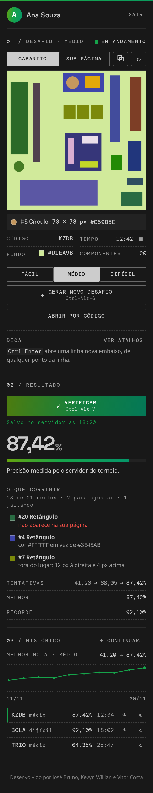
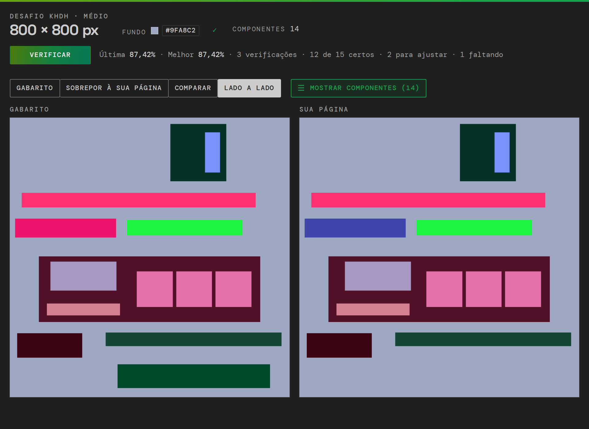

# FlexBox Trainer

Treino de recriação de layouts em HTML e CSS, no formato do torneio Frontend Teams Cup. A extensão gera um desafio (uma imagem feita de retângulos e círculos), você o recria em `index.html` e `style.css`, e o servidor do torneio corrige a sua página e devolve a precisão.

  
  &nbsp;&nbsp;
  

## Como começar

1. Instale a extensão: no VS Code, abra **Extensões** (`Ctrl+Shift+X`), procure **FlexBox Trainer** e clique em **Instalar**. Ela também está na [loja do VS Code](https://marketplace.visualstudio.com/items?itemName=josebruno10.flexbox-trainer).
2. Abra uma pasta para treinar (**Arquivo → Abrir Pasta**). Pode ser vazia: a extensão cria o `index.html` e o `style.css`.
3. Clique no ícone do **FlexBox Trainer**, na barra de atividades, e entre com **Google**, **GitHub** ou **Microsoft**, usando a conta cujo e-mail está cadastrado no torneio.
4. Escolha o nível (fácil, médio ou difícil), clique em **Gerar novo desafio** e recrie a imagem. Para treinar o mesmo desafio que a turma, use **Abrir por código**, com o código de 4 letras que o professor ou um colega passar. Clique num componente do gabarito para ver as medidas e a cor (clique numa medida ou na cor para copiar); o **⧉**, ao lado de **Sua página**, abre todos numa aba. Lá, o modo **Comparar** mostra o gabarito e a sua página na mesma imagem, divididos por uma linha que você arrasta.
5. Clique em **Verificar** (ou aperte `Ctrl+Alt+V`) para receber a precisão. Para quem está no torneio, cada verificação também salva o seu progresso no servidor, e a linha embaixo do botão mostra quando salvou. Na primeira vez, a extensão pede para criar a sua dinâmica de treino no servidor.

O guia de primeiros passos, que abre na primeira vez, mostra cada passo. O histórico guarda a sua melhor nota em cada desafio e mostra a sua evolução. Em cada linha, clique no código para copiá-lo, use **⤓** para continuar de onde parou ou **↻** para refazer do zero e bater o recorde.

Para continuar em outro computador, entre com a mesma conta e clique em **⤓** ao lado do desafio no Histórico. Se ele não estiver lá, use **⤓ Continuar…**, no topo do Histórico, e escolha ou digite o código.

## As regras, como no torneio

- Sem IA: com uma extensão de IA habilitada, não dá para começar nem corrigir. Habilitar uma durante o desafio, ou alterar os arquivos fora do editor, invalida o desafio.
- Cada desafio começa do zero: ao gerar um novo, o `index.html` e o `style.css` voltam à base.
- A extensão não dá dicas: mostra só a precisão.

## Requisitos

- VS Code 1.82 (agosto de 2023) ou mais novo, com internet.
- Uma conta no Frontend Teams Cup.

## Mais

- [Manual completo](docs/MANUAL.md): a barra lateral, a aba do gabarito, os comandos, as configurações e os problemas comuns.
- [O que mudou em cada versão](CHANGELOG.md). Instalada pela loja, a extensão se atualiza sozinha, como as outras. Sem acesso à loja, baixe o `.vsix` da [versão mais nova](https://github.com/josebruno10/flexbox-trainer/releases/latest).

Desenvolvido por José Bruno, Kevyn Willian e Vitor Costa. Licença MIT.
