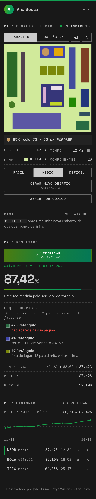
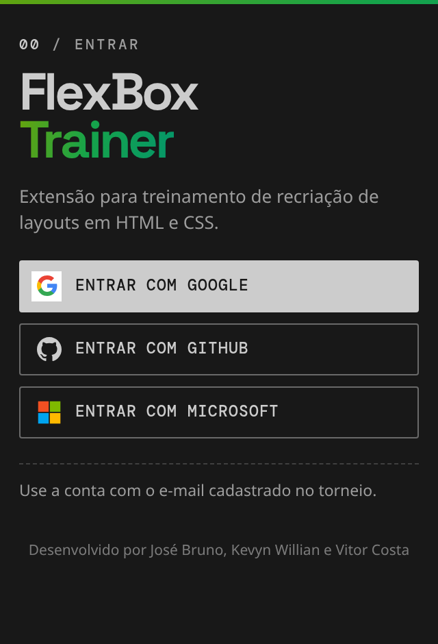
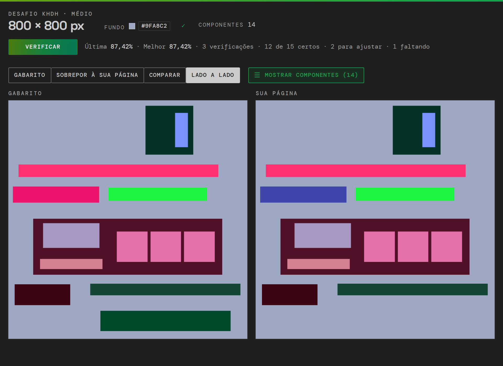
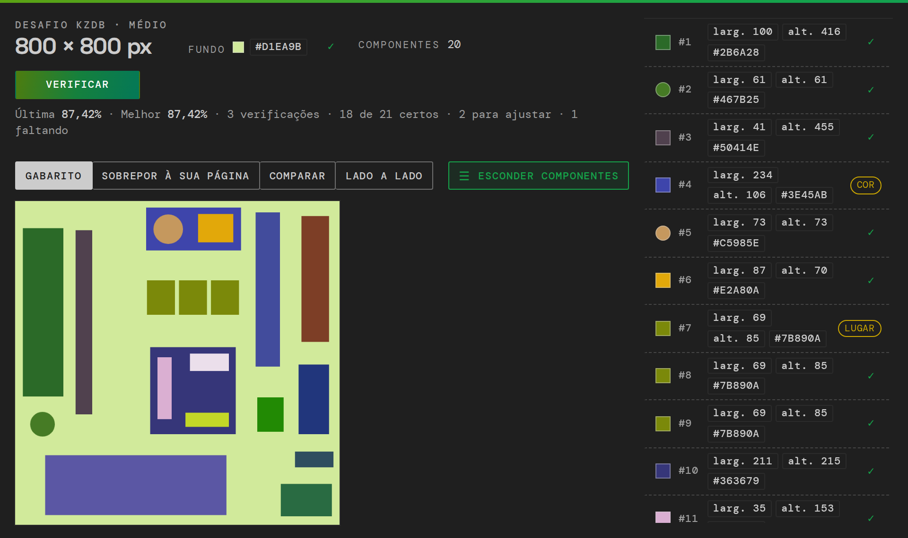

# Manual do FlexBox Trainer

Tudo sobre a extensão: instalação, uso, regras, comandos, configurações, problemas comuns e desenvolvimento. O resumo está no [README](../README.md).

<p align="center">
  
  &nbsp;&nbsp;
  
</p>

<p align="center">
  
</p>

## O que ela faz

- Gera desafios aleatórios de 800 × 800 px, com cabeçalhos, colunas, grades de cartões e fileiras de círculos, em três níveis: fácil, médio e difícil.
- Mostra o tamanho e a cor de cada componente do gabarito, na barra lateral ou em uma aba do editor.
- Atualiza a pré-visualização da sua página enquanto você digita, sem precisar salvar.
- Compara o gabarito com a sua página, sobrepostos ou lado a lado.
- Envia a sua página para o servidor do torneio corrigir e mostra a precisão oficial. As correções de treino não entram no ranking.
- Como a extensão oficial do torneio, não aceita IA durante o desafio: não deixa começar nem corrigir com extensões de IA habilitadas (Copilot, Claude Code, Codex, Continue, Cline e outras) e invalida o desafio se uma delas for habilitada ou se o código for alterado fora do editor (veja [As regras do desafio](#as-regras-do-desafio)).
- Cria o `index.html` e o `style.css` quando a pasta ainda não os tem.
- Marca o tempo de cada tentativa.
- Dá a cada desafio um código de 4 letras: com o mesmo código, a turma toda treina o mesmo layout, e o aluno pode continuar ou refazer um desafio.
- Salva o progresso de cada desafio no servidor (o `index.html` e o `style.css`), para você continuar em outro computador pelo código do desafio.
- Guarda um histórico com a melhor nota e o tempo de cada desafio, e copia o resultado para você mandar à turma.
- Mostra a sua evolução, com a melhor nota de cada dia num gráfico.
- Instalada pela loja, se atualiza sozinha. Instalada pelo `.vsix`, avisa quando sai uma versão nova e, no VS Code desktop, se atualiza com um clique.

## Requisitos

- VS Code 1.82 (agosto de 2023) ou mais novo.
- Uma conta cadastrada no Frontend Teams Cup, com o mesmo e-mail que você vai usar para entrar (de preferência pelo Google).
- Internet: a extensão valida a sua conta no servidor do torneio ao abrir, e a correção também é feita lá.

## Instalar e abrir

### Pela loja do VS Code (para treinar)

1. No VS Code, abra **Extensões** (`Ctrl+Shift+X`), procure **FlexBox Trainer** e clique em **Instalar**. Ou, no terminal: `code --install-extension josebruno10.flexbox-trainer`. A página da extensão na loja é [esta](https://marketplace.visualstudio.com/items?itemName=josebruno10.flexbox-trainer).
2. Abra uma pasta para treinar (**Arquivo → Abrir Pasta**). Pode ser uma pasta vazia: a extensão cria o `index.html` e o `style.css`.

Instalada pela loja, a extensão se atualiza sozinha, como as outras extensões do VS Code, e não mostra o aviso de versão nova do `.vsix`.

### Pelo arquivo `.vsix` (sem acesso à loja)

1. Baixe o arquivo `.vsix` da versão mais nova, em [Releases](https://github.com/josebruno10/flexbox-trainer/releases/latest) (em **Assets**).
2. No VS Code, abra **Extensões** (`Ctrl+Shift+X`), clique nos **⋯** do topo do painel e escolha **Instalar do VSIX...**. Ou, no terminal: `code --install-extension flexbox-trainer-0.8.0.vsix`.
3. Abra uma pasta para treinar (**Arquivo → Abrir Pasta**). Pode ser uma pasta vazia: a extensão cria o `index.html` e o `style.css`.

Para atualizar, instale o `.vsix` novo do mesmo jeito. Uma vez por dia, a extensão confere no GitHub se saiu uma versão nova e avisa. No VS Code desktop, **Atualizar** baixa e instala a versão nova; depois, é só recarregar a janela. No VS Code pelo navegador, **Baixar** abre a página da versão. A consulta não envia nada seu. Na primeira vez que uma versão nova abre, a extensão avisa, com o link do que mudou.

### Pelo código (para desenvolver)

Você vai precisar de Git, Node.js 20 ou mais novo e VS Code.

```bash
git clone https://github.com/josebruno10/flexbox-trainer.git
cd flexbox-trainer/extensao
npm install
code ..
```

O `code ..` abre a pasta `flexbox-trainer` no VS Code: é nela que ficam as configurações de execução (`.vscode/`), então o F5 funciona de lá. Os comandos `npm` rodam dentro de `extensao/`.

No VS Code, abra **Executar e Depurar** (`Ctrl+Shift+D`), escolha **Run Extension (Desktop)** e aperte **F5**. Uma nova janela abre com a pasta `exemplo-treino`, que já tem um `index.html` e um `style.css` de exemplo. O primeiro desafio pergunta se pode limpá-los; depois, `git restore exemplo-treino` traz o exemplo de volta.

Essa janela usa as extensões que você tem instaladas. Se alguma for de IA, você não consegue começar nem corrigir desafios até desabilitá-la (veja [Problemas comuns](#problemas-comuns)).

Se você já tinha o projeto, rode `git pull` e, dentro de `extensao/`, `npm install` antes. Para gerar o `.vsix`, rode `npm run vsix` dentro de `extensao/`: ele empacota com os links do README apontando para a pasta `extensao/` no GitHub.

## Primeiro uso

Na primeira vez que a extensão roda, ela abre o **guia de primeiros passos**, que mostra cada passo abaixo e marca o que você já fez. Para abri-lo de novo, use **FlexBox Trainer: Guia de Primeiros Passos** ou o menu **⋯** do topo da barra lateral.

1. Clique no ícone do **FlexBox Trainer** na barra de atividades, à esquerda.
2. Entre com **Google**, **GitHub** ou **Microsoft**. Use a conta cujo e-mail está cadastrado no torneio. Se o e-mail não estiver cadastrado, a barra lateral avisa em amarelo e a correção não funciona.

   Com o Google, o navegador abre direto na página de login; escolha a conta e, no fim, o VS Code volta sozinho para a frente, já com a sua conta. A aba do navegador mostra **Pronto!** e pode ser fechada. No VS Code pelo navegador, a volta é pelo endereço `vscode://`, e o navegador pede para abrir o VS Code.
3. Clique em **Gerar novo desafio**. Se a pasta aberta ainda não tiver `index.html` e `style.css`, a extensão os cria com uma base mínima e os abre. Sem pasta aberta, ela oferece **Abrir pasta**.
4. Na primeira vez que clicar em **Verificar**, a extensão pergunta se pode criar a sua **dinâmica de treino**: um espaço só seu no servidor, onde ela guarda a imagem do desafio para corrigir. Clique em **Criar dinâmica de treino** e confirme o código sugerido. Isso acontece uma única vez.

## Como treinar

1. Escolha o nível logo acima de **Gerar novo desafio**: **Fácil**, **Médio** ou **Difícil**. Nos mais fáceis saem os componentes menores, que dão mais trabalho (75% deles no fácil, sem nunca ficar com menos de 8, e 30% no médio); o difícil tem todos. A escolha fica guardada. **Gerar novo desafio** (`Ctrl+Alt+G`) cria uma imagem nova e deixa o `index.html` e o `style.css` só com a base. Gere quantas quiser até achar um desafio para treinar; o cronômetro recomeça a cada desafio. Para treinar um desafio que alguém passou, use **Abrir por código**, logo embaixo, e digite as 4 letras.
2. Recrie a imagem em `index.html` e `style.css`. Pode usar flexbox, grid ou `position`: o que conta é o resultado na tela. A sua página é desenhada numa área do tamanho do gabarito (800 × 800 px), como no torneio: o `html` e o `body` já têm esse tamanho, e o que passar dele fica de fora. Não precisa definir o tamanho da página; basta preencher essa área (por exemplo, com `height: 100%` no elemento que envolve o layout).
3. Para consultar medidas e cores, clique em um componente do gabarito na barra lateral: clique na largura, na altura ou na cor para copiar (já com `px`). O **⧉**, ao lado de **Sua página**, abre todos numa aba. A cor do **Fundo**, nos dados do desafio, também se copia com um clique.
4. A pré-visualização e a comparação acompanham o que você digita, sem precisar salvar. Na barra lateral, **Gabarito | Sua página** alterna os dois no mesmo quadro, o que deixa à vista onde eles diferem. Para comparar de perto, use o modo **Comparar** da aba do gabarito (veja abaixo).
5. Clique em **Verificar** (ou aperte `Ctrl+Alt+V`, mesmo com a barra lateral fechada). A barra lateral mostra as etapas e, no fim, a precisão medida pelo servidor do torneio. Cada verificação também salva o seu progresso no servidor: a linha embaixo do botão diz quando salvou (veja [Continuar em outro computador](#continuar-em-outro-computador)).
6. Embaixo da nota, **O que corrigir** mostra, pela correção do servidor, os componentes que mais tiram pontos e o que está diferente em cada um: "não aparece na sua página", a cor ("cor #FFFFFF em vez de #1930F8"), o tamanho ("60 × 150 px em vez de 60 × 166 px"), o lugar ("fora do lugar: 12 px à direita e 4 px acima") ou a forma ("deveria ser um círculo"). Também aparecem as formas a mais, que a sua página tem e o gabarito não. Clique num componente da lista para vê-lo destacado no gabarito. A lista completa fica na aba do gabarito, com uma marca em cada componente.
7. Ajuste e verifique de novo. Abaixo da nota ficam as últimas tentativas do desafio e a melhor delas. Se a sua página não mudou desde a última verificação, a extensão não a reenvia: ela repete a nota e avisa.
8. **⏹**, ao lado do tempo, encerra o desafio e congela o cronômetro quando você terminar. No mesmo lugar, aparece **↻**, que refaz o mesmo desafio, do zero.

Só contam elementos com cor de fundo sólida (`background` ou `background-color`). Texto, imagens, gradientes e sombras não são comparados.

### Código do desafio e histórico

Cada desafio tem um **código** de 4 letras (como `MESA`), que aparece nos dados do desafio (clique nele para copiar) e no topo da aba do gabarito. O mesmo código gera sempre a mesma imagem, no mesmo nível: o nível vem do próprio código, e aparece no título da seção (por exemplo, **Desafio · médio**). Quem abre o código de um colega treina o mesmo nível dele, qualquer que seja o nível escolhido.

- **Em sala ou com um colega:** alguém passa um código, e cada um abre o desafio com **Abrir por código**. Todos treinam o mesmo layout, cada um na própria dinâmica de treino.
- **Sozinho:** refaça um desafio para tentar uma nota maior ou um tempo menor.

O **Histórico**, abaixo do Resultado, mostra os desafios que você já verificou, do mais recente ao mais antigo, com a melhor nota e o tempo em que ela foi alcançada. Em cada linha, clique no código para copiá-lo; **⤓** continua o desafio de onde você parou, com o `index.html` e o `style.css` salvos (aparece quando há progresso salvo; veja [Continuar em outro computador](#continuar-em-outro-computador)); **↻** refaz o desafio do zero, com os arquivos limpos, para tentar uma nota maior ou um tempo menor. **Ver todos** (ou **FlexBox Trainer: Histórico de Desafios**) lista até 30. Ao refazer um desafio, o Resultado mostra também o seu **Recorde** nele, a nota a bater.

No topo do Histórico, o gráfico **Melhor nota** mostra a sua evolução no nível escolhido: a melhor nota de cada dia, de 0 a 100%, com a primeira e a última nota ao lado do título. Ele aparece desde o primeiro dia, como um ponto; a linha surge a partir do segundo dia de treino. Pare o mouse sobre um ponto para ver o dia e a nota.

O histórico fica separado por e-mail: num laboratório, cada aluno vê os próprios desafios. Com a **Sincronização de Configurações** do VS Code ligada (ícone da conta, embaixo à esquerda), o histórico e o gráfico vão com você para os outros computadores em que você usar o VS Code, junto com o nível escolhido. Só os seus: os de outros alunos que usaram o mesmo computador não vão.

O comando **FlexBox Trainer: Copiar Resultado**, na paleta, copia o código, a melhor nota desta tentativa e o tempo em que ela saiu, para colar no grupo da turma:

```text
Desafio médio MESA: 87,42% em 12:34
```

### Continuar em outro computador

Cada desafio pode ter um progresso salvo no servidor. Para quem está no torneio, a cada **Verificar** a extensão guarda sozinha o `index.html` e o `style.css` do desafio atual numa dinâmica com o mesmo código dele: o desafio `MESA` fica na dinâmica `mesa`. A extensão cria essa dinâmica no primeiro salvamento, e o servidor guarda os arquivos numa pasta sua dentro dela, pelas mesmas rotas da extensão oficial do torneio (`criar-pasta`, `salvar-conteudo` e `obter-conteudo`). Salvar de novo o mesmo desafio substitui o que estava salvo nele; os outros desafios não mudam. Embaixo do **Verificar**, uma linha mostra o que acontece: **Cada verificação salva o seu progresso no servidor.** antes da primeira, **Salvando no servidor…** e depois **Salvo no servidor às 14:32.** Se não der para salvar (por exemplo, sem internet), a linha avisa, e a extensão não insiste naquele desafio até você reabrir o VS Code. **Salvar Progresso no Servidor**, no menu **⋯**, salva na hora e avisa o resultado.

Para continuar, em qualquer computador, entre com a mesma conta e clique em **⤓** ao lado do desafio, no Histórico. Se ele não estiver no Histórico (por exemplo, num computador sem a Sincronização de Configurações), clique em **⤓ Continuar…**, no topo do Histórico: a extensão lista os desafios que você salvou; escolha um, ou **Digitar outro código…**. Os dois fazem a mesma coisa: trazem o que está no servidor para aquele código, abrem o desafio e gravam nele os seus arquivos. Se a pasta aberta já tiver algo escrito, ela pergunta antes de substituir. O cronômetro recomeça.

A lista dos desafios salvos acompanha você pela **Sincronização de Configurações**. Sem ela, digite o código no outro computador: depois de continuar, dá para voltar a salvar ali normalmente.

A extensão só salva numa dinâmica que ela mesma criou para você. Se já existir no servidor uma dinâmica com o código do desafio, criada por outra pessoa, ela pode ser do torneio, e o progresso desse desafio não é salvo (continuar funciona, porque só lê). Só quem está no torneio salva e continua desafios salvos, como acontece na correção. O histórico de notas não vai pelo servidor; ele acompanha você pela Sincronização de Configurações (veja acima).

### Cópias de segurança

Antes de apagar ou substituir o que você escreveu no `index.html` e no `style.css` (num desafio novo, ao continuar um desafio salvo ou ao restaurar uma cópia), a extensão guarda uma cópia deles neste computador, como o "Restaurar Backup Local Seguro" da extensão oficial. Para voltar a uma, rode **FlexBox Trainer: Restaurar Cópia de Segurança** (também no menu **⋯**): a lista mostra o desafio de cada cópia e quando ela foi feita. Escolhida uma, a extensão abre o desafio dela com os arquivos dela, e os arquivos de agora também viram uma cópia; o cronômetro recomeça. Ficam as 10 cópias mais recentes, separadas por aluno (no laboratório, um não vê as do outro), e elas não vão pela Sincronização de Configurações.

## As regras do desafio

Como no torneio, o desafio é feito do começo ao fim no editor, sem IA:

- Não dá para começar um desafio com extensões de IA habilitadas no VS Code.
- Se uma extensão de IA for habilitada durante o desafio, ele é **invalidado**, mesmo que você a desabilite depois.
- Se o `index.html` ou o `style.css` forem alterados fora do editor durante o desafio, ele também é invalidado. Isso pega assistentes de IA que rodam no terminal e gravam direto nos arquivos, mas vale para qualquer programa ou comando (outra janela do VS Code, `git checkout`, um formatador rodado no terminal).
- Um desafio invalidado não pode mais ser corrigido: a barra lateral mostra o motivo, e é só gerar outro.
- Cada desafio começa do zero. Ao gerar um desafio novo, o `index.html` e o `style.css` voltam à base (o HTML mínimo e o reset do CSS: `box-sizing`, `margin` e `padding`), para nada do desafio anterior ser reaproveitado e o tempo contar o desafio inteiro. Se você escreveu algo, a extensão pergunta antes de limpar; com o arquivo aberto, `Ctrl+Z` no editor desfaz a limpeza. A exceção é continuar um desafio salvo (o **⤓** do Histórico ou **Puxar…**): o desafio recomeça com os arquivos que você mesmo salvou.

Salvar no editor, inclusive com formatação ao salvar, e criar, limpar ou trazer os arquivos pela extensão não contam como alteração de fora.

## A barra lateral

A barra lateral tem três partes: **Desafio** (o quadro, que alterna entre o gabarito e a sua página, as medidas e os dados do gabarito, com o código), **Resultado** (o **Verificar**, a precisão, o que corrigir e as tentativas) e **Histórico**, com os desafios que você já verificou. Se faltar o `index.html` ou o `style.css` na pasta aberta, o Resultado avisa e oferece criá-los. O caminho dos arquivos usados aparece ao parar o mouse sobre **Sua página**.

| Botão | O que faz |
|---|---|
| Gabarito, Sua página | Alternam o que o quadro mostra: o gabarito ou a sua página |
| Fácil, Médio, Difícil | Escolhem o nível dos desafios novos; a escolha fica guardada |
| Gerar novo desafio | Cria um desafio novo, no nível escolhido, e reinicia o cronômetro (`Ctrl+Alt+G`) |
| Abrir por código | Abre o desafio de um código de 4 letras, como o que o professor ou um colega passar |
| O código e a cor do fundo, nos dados do desafio | Copiam o valor: o código, para outra pessoa abrir o mesmo desafio; a cor, para o CSS |
| A largura, a altura e a cor de um componente | Copiam o valor, já com `px` nas medidas |
| ⏹, ao lado do tempo | Encerra o desafio e congela o cronômetro |
| ↻, ao lado do tempo | Aparece depois de encerrar, no lugar do ⏹; começa o mesmo desafio de novo, do zero (`Ctrl+Alt+Shift+N`) |
| ⧉ (ao lado de Sua página) | Abre o gabarito, as medidas e a comparação em uma aba do editor (`Ctrl+Alt+A`) |
| ↻ (ao lado de Sua página) | Atualiza a sua página na hora. Ela já atualiza sozinha enquanto você digita; use se demorar |
| Criar index.html e style.css | Aparece quando falta algum dos dois; cria só o que falta, sem sobrescrever nada |
| Ver extensões | Aparece no aviso de extensões de IA; abre a página delas para você desabilitar |
| Verificar | Mede a sua página e envia para a correção (`Ctrl+Alt+V`); para quem está no torneio, também salva o progresso |
| O código, no Histórico | Copia o código |
| ⤓, no Histórico | Aparece quando há progresso salvo; continua aquele desafio com os seus arquivos |
| ↻, no Histórico | Refaz aquele desafio do zero |
| ⤓ Continuar…, no Histórico | Lista os desafios salvos, ou pede um código, e abre o escolhido com os seus arquivos |
| Ver todos, no Histórico | Lista todos os desafios do histórico; escolher um o refaz (`Ctrl+Alt+H`) |
| Sair | Encerra a sua sessão |

Enquanto há um desafio, a barra de status, embaixo da janela, mostra o tempo e a última precisão, mesmo com a barra lateral fechada. Clique nela para abrir a barra lateral.

No topo da barra lateral, o ícone de paleta escolhe as cores de destaque da extensão (veja [Configurações](#configurações)), e o menu **⋯** tem **Abrir Desafio por Código**, **Refazer o Desafio Atual**, **Histórico de Desafios**, **Salvar Progresso no Servidor**, **Continuar Desafio Salvo**, **Restaurar Cópia de Segurança**, o **Guia de Primeiros Passos**, os **Atalhos e Abreviações Emmet** e o **Testar Servidor**, que confere se a sua sessão está valendo. A extensão já testa o servidor sozinha a cada desafio novo e só avisa se der erro.

## A aba do gabarito

Abra pelo **⧉**, ao lado de **Sua página**, pelo atalho **Abrir gabarito em uma aba** que aparece no topo do `index.html` e do `style.css`, ou pela paleta de comandos. A aba acompanha o desafio atual e tem quatro modos:

- **Gabarito**: a imagem grande e a lista de todos os componentes, um por linha, com largura, altura e cor. Os círculos também aparecem em largura e altura, como você os faz com `border-radius`, e têm a amostra redonda. Clique em um componente, na imagem ou na lista, para destacá-lo por alguns segundos (Esc tira o destaque na hora); clique em um valor para copiá-lo.
- **Sobrepor à sua página**: o gabarito por cima da sua página. Arraste o controle entre "Sua página" e "Gabarito" para ver onde cada uma difere.
- **Comparar**: o gabarito e a sua página na mesma imagem, divididos por uma linha, como na extensão oficial do torneio. Arraste a linha, ou use as setas do teclado, para ver o gabarito à esquerda e a sua página à direita.
- **Lado a lado**: o gabarito e a sua página, um ao lado do outro. A lista começa escondida, para as imagens ficarem maiores.

O botão **Componentes** mostra ou esconde a lista em qualquer modo.

No topo da aba fica o **Verificar** (`Ctrl+Alt+V`), com a última nota, a melhor, quantas verificações você fez e quantos componentes estão certos. Depois de uma verificação, cada componente da lista (e o fundo) ganha uma marca: **✓**, ou o que falta acertar (**falta**, **cor**, **tamanho**, **lugar** ou **forma**); pare o mouse sobre a marca para ver os valores. Ele faz o mesmo que o botão da barra lateral, que é onde a sua página é medida: a barra se abre, se estiver fechada, e a aba mostra as etapas até a nota chegar.

A sua página aparece na aba exatamente como ela é medida para a correção, e acompanha o que você digita.

<p align="center">
  
</p>

## Comandos

Abra a paleta com `Ctrl+Shift+P` e digite "FlexBox Trainer".

| Comando | O que faz |
|---|---|
| FlexBox Trainer: Fazer Login | Abre o login pelo Google no navegador |
| FlexBox Trainer: Sair | Encerra a sessão |
| FlexBox Trainer: Iniciar | Abre a barra lateral (e o login, se precisar) |
| FlexBox Trainer: Gerar Novo Desafio | Sorteia um desafio novo |
| FlexBox Trainer: Abrir Desafio por Código | Abre o desafio de um código de 4 letras |
| FlexBox Trainer: Verificar | Verifica a sua página, como o botão da barra lateral |
| FlexBox Trainer: Copiar Resultado | Copia o código, a melhor nota e o tempo do desafio atual |
| FlexBox Trainer: Refazer o Desafio Atual | Começa o desafio atual de novo, do zero |
| FlexBox Trainer: Histórico de Desafios | Lista os desafios já verificados; escolher um o refaz |
| FlexBox Trainer: Salvar Progresso no Servidor | Guarda no servidor o `index.html` e o `style.css` do desafio atual |
| FlexBox Trainer: Continuar Desafio Salvo | Pede o código de um desafio salvo e o abre com os arquivos salvos, como o ⤓ Continuar… do Histórico |
| FlexBox Trainer: Restaurar Cópia de Segurança | Volta uma das cópias que a extensão guarda antes de apagar ou substituir os seus arquivos |
| FlexBox Trainer: Guia de Primeiros Passos | Abre o guia na tela de boas-vindas do VS Code |
| FlexBox Trainer: Atalhos e Abreviações Emmet | Abre, numa aba, os atalhos da extensão e do editor e as abreviações Emmet de HTML e CSS |
| FlexBox Trainer: Abrir Gabarito em uma Aba | Abre a aba do gabarito |
| FlexBox Trainer: Criar index.html e style.css | Cria na pasta aberta os arquivos que faltarem |
| FlexBox Trainer: Ver Extensões de IA Habilitadas | Mostra as extensões de IA que impedem começar e corrigir desafios e abre a página delas |
| FlexBox Trainer: Criar Dinâmica de Treino | Cria a sua dinâmica de treino, se você não a criou no primeiro Verificar |
| FlexBox Trainer: Usar Minha Dinâmica de Treino | Num computador novo, usa a dinâmica que você já criou em outro, sem criar outra |
| FlexBox Trainer: Testar Servidor | Confere se a sua sessão está valendo no servidor |
| FlexBox Trainer: Escolher Cores | Troca as cores de destaque da extensão |

## Atalhos

| Atalho | O que faz |
|---|---|
| `Ctrl+Alt+G` | Gera um novo desafio |
| `Ctrl+Alt+V` | Verifica a sua página; abre a barra lateral, se estiver fechada |
| `Ctrl+Alt+A` | Abre o gabarito em uma aba |
| `Ctrl+Alt+Shift+N` | Refaz o desafio atual, do zero |
| `Ctrl+Alt+H` | Mostra o histórico de desafios |

Para lembrar: **G** de gerar, **V** de verificar, **A** de aba, **N** de novo e **H** de histórico. Os atalhos funcionam a qualquer momento, até com a barra lateral fechada logo ao abrir o VS Code; sem sessão ou sem desafio, a extensão diz o que falta. **Gerar novo desafio** e **Verificar** mostram o atalho embaixo do texto; nos outros botões, ele aparece ao parar o mouse em cima.

Se um atalho não fizer nada, o sistema pode estar usando a mesma tecla (no Xfce, por exemplo, `Ctrl+Alt+D` mostra a área de trabalho). Para conferir, rode **Developer: Toggle Keyboard Shortcuts Troubleshooting** na paleta e aperte o atalho: se nada aparecer no painel **Saída**, a tecla não chegou ao VS Code. Dá para trocar qualquer atalho em **Arquivo → Preferências → Atalhos de Teclado**, procurando "FlexBox Trainer".

### Dicas de digitação

No fim da seção Desafio, uma **Dica** ensina um atalho do editor ou uma abreviação **Emmet**, que já vem no VS Code: por exemplo, no `style.css`, `jcc` e Tab viram `justify-content: center;`, e no `index.html`, `.linha>.item*3` e Tab criam uma `.linha` com três `.item` dentro. A dica muda a cada desafio novo. **Ver atalhos**, ao lado dela (ou **FlexBox Trainer: Atalhos e Abreviações Emmet**, no menu **⋯**), abre todos numa aba. As dicas são só sobre digitar mais rápido: nenhuma diz nada sobre o desafio.

No Mac, use Control e Option no lugar de Ctrl e Alt. As teclas foram escolhidas para não tirar atalhos do VS Code nem do Ubuntu e para não atrapalhar quem digita `/`, `?` e `°` com AltGr no teclado ABNT2, no Windows. Para trocar um atalho, abra **Arquivo → Preferências → Atalhos de Teclado** e busque por "FlexBox Trainer".

## Configurações

Em **Arquivo → Preferências → Configurações**, aba **Usuário**, busque por "flexboxTrainer".

| Configuração | Para que serve |
|---|---|
| `flexboxTrainer.eventoTreino` | Código da sua dinâmica de treino. É preenchido sozinho quando você cria a dinâmica |
| `flexboxTrainer.modoDesenvolvedor` | Mostra ferramentas de teste. Deixe desligado para treinar |
| `flexboxTrainer.temaCores` | Cores de destaque: Floresta (a padrão, em verdes), Campus (verde com toques de vermelho), Oceano, Noite, Violeta, Magenta, Pôr do sol, Grafite ou as do tema do VS Code. Muda só o degradê, o botão principal e os destaques; o resto segue o tema do VS Code |
| `flexboxTrainer.apiBaseUrl`, `flexboxTrainer.authApiBaseUrl` | Endereço da API do torneio. Não precisa mudar |
| `flexboxTrainer.authSiteUrl`, `flexboxTrainer.googleClientId` | Site e cliente do login pelo Google. Não precisa mudar |
| `flexboxTrainer.apiToken` | Token manual, só para desenvolvimento |

## Problemas comuns

**A barra lateral avisa que há extensões de IA habilitadas.**
Como no torneio, você só começa e corrige desafios sem elas. Clique em **Ver extensões** no aviso (ou rode **FlexBox Trainer: Ver Extensões de IA Habilitadas**) e, na página de cada uma, clique em **Desabilitar**. Se o VS Code mostrar **Reiniciar Extensões**, clique: uma extensão que já estava rodando só sai depois disso. Então o aviso some. Isso vale também para o GitHub Copilot que vem com o VS Code, se você o tiver habilitado.

**O meu desafio foi invalidado.**
A barra lateral mostra o motivo: uma extensão de IA foi habilitada durante o desafio, ou o `index.html` ou o `style.css` foram alterados fora do editor. Veja [As regras do desafio](#as-regras-do-desafio). Gere um novo desafio e faça-o no editor, sem IA.

**A barra lateral avisa que o meu e-mail não está cadastrado no torneio.**
Você entrou com uma conta cujo e-mail não existe no torneio (é comum com GitHub ou Microsoft, quando o e-mail deles é outro). A extensão procura o aluno por todos os e-mails verificados da conta; no GitHub, dá para adicionar e confirmar o e-mail do torneio em github.com/settings/emails e entrar de novo. Senão, clique em **Sair** e entre com a conta cadastrada, de preferência pelo Google. A extensão não cadastra ninguém no torneio: sem cadastro no Frontend Teams Cup, dá para gerar desafios e treinar, mas não para corrigir.

**Ao apertar F5, apareceu "Select debugger" ou a tela "Run and Debug".**
O VS Code não abriu a pasta certa. Use **Arquivo → Abrir Pasta** e escolha a pasta `flexbox-trainer`, a que tem `package.json`, `src` e `.vscode` dentro. Se aparecer o aviso de confiança, responda que confia nos autores.

**A tarefa terminou com o código de saída 127.**
O VS Code não encontrou o `npm`. Acontece quando o Node foi instalado pelo nvm e o VS Code foi aberto pelo menu. Abra o VS Code pelo terminal, de dentro da pasta do projeto, com `code .`.

**O login do GitHub ou da Microsoft não abre.**
Feche a janela de teste e abra de novo. Se continuar, confira em **Extensões** (busque `@builtin GitHub Authentication` ou `Microsoft Authentication`) se a extensão de login embutida está habilitada. No VS Code pelo navegador, o login da Microsoft não está disponível.

**A minha página parece igual ao gabarito, mas a nota está baixa.**
Confira se todos os elementos usam cor de fundo sólida e se as medidas batem exatamente; use os modos **Comparar** ou **Sobrepor à sua página** da aba do gabarito para ver as diferenças.

**O código da dinâmica de treino foi recusado.**
O servidor aceita no máximo 4 caracteres (letras minúsculas e números). Se o código sugerido já existir, escolha outro.

**Num computador novo, a extensão diz que a minha dinâmica já existe.**
Ela é a que você criou no outro computador. Em vez de criar outra, clique em **Já tenho uma** (ou use **FlexBox Trainer: Usar Minha Dinâmica de Treino**) e confirme o código dela.

## Para quem desenvolve

No repositório, a extensão inteira fica em `extensao/`, inclusive o `.gitignore` e a licença. Na raiz ficam só a pasta `.github/`, com os fluxos do GitHub (que só funcionam ali) e o README curto que o GitHub mostra na página do repositório, e a `.vscode/`, com as configurações de execução, que o VS Code só lê na pasta aberta. Assim dá para pôr outras partes do projeto ao lado da extensão.

Dentro de `extensao/`, o código fica em `src/web` (a extensão roda no extension host web do VS Code):

| Pasta | Conteúdo |
|---|---|
| `auth/` | Login pelo Google (site externo), GitHub e Microsoft, e a sessão com o servidor: `authService.ts` coordena; as rotas do torneio, o perfil dos provedores e a leitura das respostas ficam em módulos ao lado. No desktop, o login com Google passa por um servidor só da máquina (`retornoLocal.ts`, em 127.0.0.1): o VS Code abre um endereço local, que ele não pede para confirmar, e o site devolve o login a esse servidor num formulário (POST), para o token não ficar no histórico do navegador |
| `provider/` | A barra lateral e a aba do gabarito. `provedorBarraLateral.ts` guarda o estado e coordena; as partes dele (verificação, correção, histórico, progresso no servidor, mensagens, regras do treino, conexão) ficam em `provider/barraLateral/` |
| `services/` | Gerador de desafios, correção, dinâmica de treino, chamadas ao servidor e leitura dos arquivos. As rotas do servidor ficam em `services/servidor/` (pedidos, gabaritos, correção, dinâmica, conteúdo do aluno e conexão) e as partes do gerador em `services/gerador/` (sorteios, cores, padrões, regiões e níveis), com a entrada em `services/desafio.ts` |
| `atalhos/` | Os atalhos da extensão (a mesma lista do `package.json`, conferida por um teste), os do editor e as abreviações Emmet, de onde saem os atalhos dos botões, a dica da barra lateral e a aba Atalhos. Cada abreviação foi conferida num VS Code de verdade; algumas que parecem óbvias (`fdc`, `fww`, `jcsa`) não fazem o esperado |
| `telas/` | Roda na extensão: o HTML das quatro telas (barra lateral, aba do gabarito, aba Atalhos e entrada), com o CSS de cada parte em `telas/estilos/`, e os temas de cores |
| `webview/` | Roda dentro das telas, no navegador da webview: `app.ts` (barra lateral), `painelGabarito.ts` (aba) e `loginPage.ts` (entrada) recebem as mensagens da extensão; as partes de cada um ficam em `webview/barra/` e `webview/aba/`, e o desenho do gabarito, a página do aluno e a medição das formas (`webview/formas/`) servem às duas |
| `test/suite/` | Testes automatizados, com uma pasta por assunto grande (`auth/`, `barraLateral/`) |
| `scripts/e2e/` | Teste de ponta a ponta da atualização, num VS Code de verdade |

Cada arquivo trata de um assunto e fica pequeno (em geral, até umas 400 linhas). Os coordenadores, como `provedorBarraLateral.ts` e `authService.ts`, são maiores, mas só guardam o estado e ligam as partes. Ao mexer num arquivo que passou disso, divida-o por assunto junto com a mudança, com os testes passando antes e depois. Os arquivos de código têm nomes em camelCase (`historicoDoAluno.ts`), e as pastas também.

No desktop, a extensão roda no host Node do VS Code (`dist/node`), o mesmo das outras extensões; é de lá que ela consegue ver as extensões de IA. No VS Code pelo navegador, roda no host web (`dist/web`). O código é o mesmo para os dois.

Há duas configurações de execução:

- **Run Extension (Desktop)**: igual à instalação dos alunos, com as suas extensões. As de IA impedem começar e corrigir desafios.
- **Run Extension (Desktop, sem outras extensões)**: abre a janela de teste sem as suas extensões instaladas (as embutidas do VS Code continuam). Use para testar a correção se você desenvolve com Copilot, Claude Code ou outra extensão de IA.

```bash
npm run compile-web   # compila
npm run watch-web     # compila a cada alteração
npm run lint          # verifica o estilo do código
npm test              # roda os testes em um VS Code no Chromium
npm run test:desktop  # roda os mesmos testes no VS Code desktop
npm run typecheck     # confere os tipos e acusa código sem uso
npm run test:e2e -- <.vsix anterior> <versão nova>  # atualização de ponta a ponta
```

Os testes simulam as respostas do servidor e não criam dados reais. O `npm test` só passa se o resumo dos testes aparecer na saída: sem rede para baixar o VS Code, o `vscode-test-web` sai com sucesso sem rodar nada. O `npm run test:desktop` usa o `code` instalado; com `VSCODE_TESTE_BAIXAR=1` (e no GitHub), baixa um VS Code na pasta `.vscode-test`, que fica fora do Git e do `.vsix`.

### No GitHub

- **A cada envio ao `main`** (e em pull requests), o fluxo **Testes** confere tipos e estilo, roda as duas suítes e gera o `.vsix`. O selo no topo do README mostra se a última execução no `main` passou. Para testar uma mudança antes da versão, baixe o `.vsix` em **Actions → a execução → Artifacts**.
- **Ao publicar uma versão** em Releases, o fluxo **Versão** confere que a etiqueta bate com a versão do `package.json` (por exemplo, `v0.5.0` e `0.5.0`), roda os testes e anexa o `.vsix` à versão. Basta criar a versão pelo site do GitHub; um `.vsix` anexado à mão é substituído. Depois, o teste de ponta a ponta instala a versão anterior num VS Code limpo e confere que ela avisa da nova, se atualiza com um clique e mostra o que mudou; se falhar, as fotos da tela ficam em **Artifacts**. Ele precisa da rede e da versão já publicada, por isso não roda a cada envio.
- **Na loja do VS Code**, a versão nova não entra sozinha: depois de criar a versão em Releases, envie o mesmo `.vsix` em [marketplace.visualstudio.com/manage](https://marketplace.visualstudio.com/manage), nos **⋯** da extensão, em **Update**. O publicador é `josebruno10`.

O gerador, em `services/desafio.ts`, é a porta do script do Vitor (commit `271c492`). Os níveis tiram os componentes menores (75% no fácil, 30% no médio; o script do Vitor tira 50% no fácil, mas assim o fácil parecia um médio), um padrão inteiro por vez (uma sequência ou uma fileira de círculos nunca fica pela metade), e nunca deixam menos de 8. O nível vem do código: as 4 letras são lidas como um número de base 26 (`AAAA` é 0, `AAAB` é 1, `ZZZZ` é 456.975), e o resto da divisão dele por 3 dá o nível (0 é fácil, 1 é médio, 2 é difícil).

Os códigos de desafio dependem do gerador: se ele mudar, os códigos já passados à turma geram outros desafios. Um teste em `codigoDesafio.test.ts` avisa quando isso acontece.

Com `flexboxTrainer.modoDesenvolvedor` ligado, o comando **FlexBox Trainer: Gerar Solução Exata do Desafio (teste)** grava em `index.html` e `style.css` uma página que reproduz o desafio pixel a pixel (com flexbox ou com posição absoluta), para testar se a correção chega a 100%. Ele entrega a resposta, então fica escondido para os alunos.

O servidor é o mesmo da competição. Nunca exclua dados nele e evite testar às terças à noite, quando ele está em uso.

## Créditos

Desenvolvido por José Bruno, Kevyn Willian e Vitor Costa.

## Licença

MIT (veja [LICENSE](../LICENSE)). As fontes Space Grotesk e DM Mono, em `media/fontes`, seguem a licença SIL Open Font License 1.1, com os textos ao lado delas.
